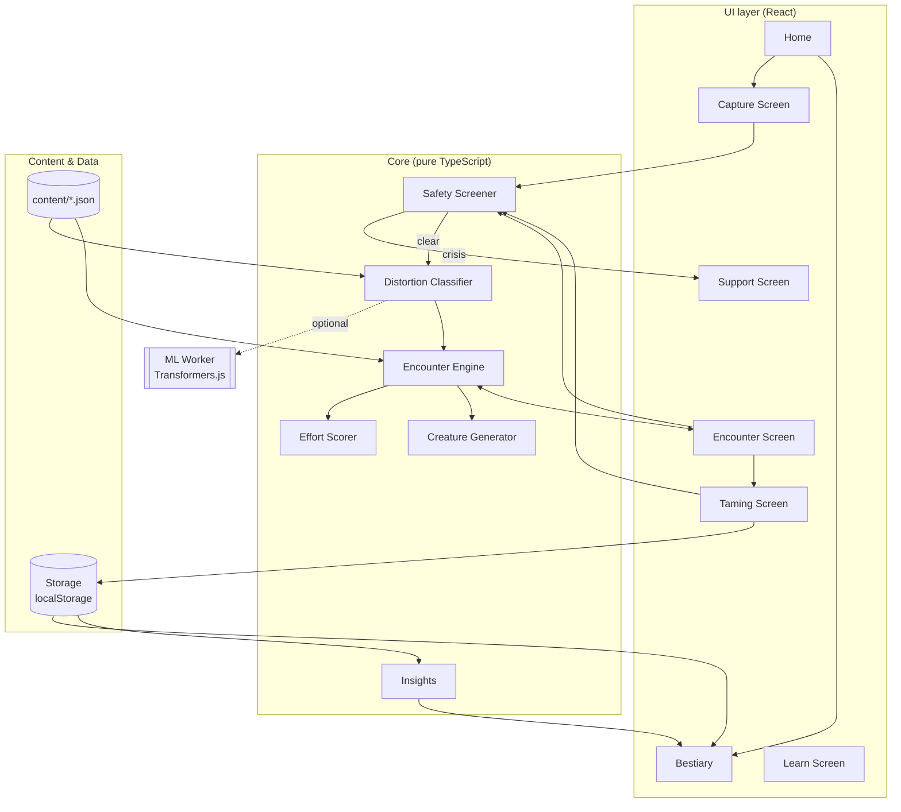
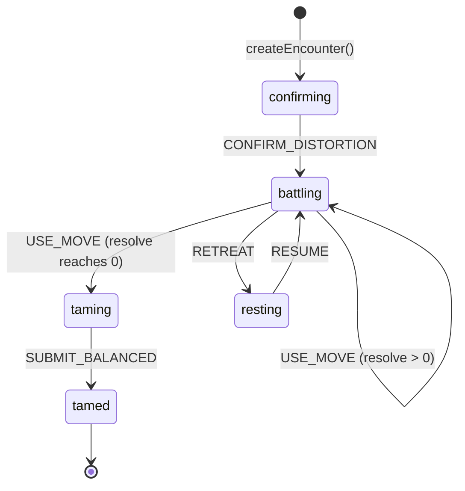
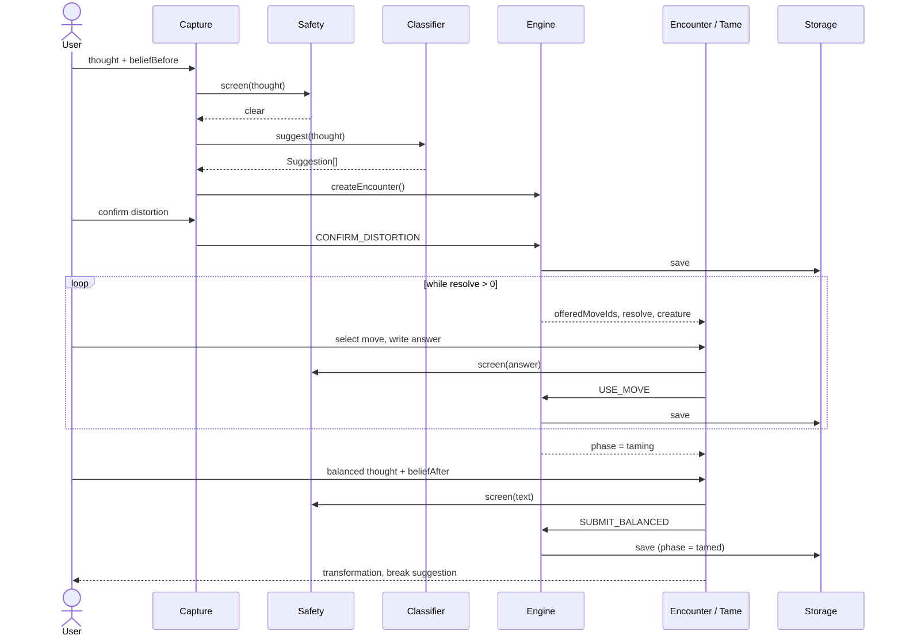

# Thought Dungeon — Architecture Specification

**Related documents:** `requirements.md`

---

## 1. Overview

Thought Dungeon is a **client-only single-page web application**. There is no server: all logic runs in the browser and all data persists to `localStorage`. The application is deployed as static files to GitHub Pages.

### 1.1 Technology stack

| Layer | Technology |
|---|---|
| Build tooling | Vite, TypeScript |
| UI framework | React 18 |
| State management | Zustand |
| Styling | CSS Modules with CSS custom properties for theme tokens |
| Animation | CSS transitions; Framer Motion for creature transforms |
| Creature rendering | Procedurally generated SVG |
| Iconography | game-icons.net (CC BY 3.0), Lucide |
| ML inference (optional) | Transformers.js in a Web Worker |
| Testing | Vitest |
| Deployment | GitHub Pages via GitHub Actions |

### 1.2 Layering rule

The codebase has three layers with one-way dependencies:

```
UI (React)  →  Core (pure TypeScript)  →  Content & Data
```

- **Core** modules contain no React, DOM, or browser-storage access. They are deterministic given their inputs (randomness is injected via a seeded PRNG) and are fully unit-tested.
- **UI** modules call into Core and render the state it returns. UI modules contain no game rules.
- **Data** (`storage.ts`) is the only module that touches `localStorage`.

## 2. System diagram



## 3. Repository structure

```
thought-dungeon/
├── README.md
├── docs/
│   ├── requirements.md
│   └── architecture.md
├── public/
│   ├── sounds/
│   └── icons/
├── src/
│   ├── main.tsx
│   ├── App.tsx                  # router, layout, persistent safety notice
│   ├── theme.css                # palette, radii, typography tokens
│   ├── core/
│   │   ├── types.ts
│   │   ├── rng.ts               # seeded PRNG (mulberry32) + string hash
│   │   ├── safety.ts
│   │   ├── classifier/
│   │   │   ├── index.ts         # Classifier interface, CompositeClassifier
│   │   │   ├── keyword.ts
│   │   │   └── mlClient.ts
│   │   ├── engine.ts
│   │   ├── scorer.ts
│   │   ├── creature.ts
│   │   └── insights.ts
│   ├── content/
│   │   ├── distortions.json
│   │   ├── moves.json
│   │   └── lines.json
│   ├── data/
│   │   └── storage.ts
│   ├── workers/
│   │   └── ml.worker.ts
│   ├── components/
│   │   ├── Creature.tsx
│   │   ├── ResolveBar.tsx
│   │   ├── MoveCard.tsx
│   │   └── BeliefSlider.tsx
│   └── screens/
│       ├── Home.tsx
│       ├── Capture.tsx
│       ├── Encounter.tsx
│       ├── Tame.tsx
│       ├── Bestiary.tsx
│       ├── Learn.tsx
│       └── Support.tsx
└── tests/
    ├── engine.test.ts
    ├── classifier.test.ts
    ├── scorer.test.ts
    ├── safety.test.ts
    └── storage.test.ts
```

## 4. Data model

Defined in `src/core/types.ts`. This file is the shared contract between all modules.

```ts
export type DistortionId =
  | "catastrophizing" | "mind_reading" | "fortune_telling" | "all_or_nothing"
  | "overgeneralization" | "should_statements" | "labeling"
  | "emotional_reasoning" | "personalization" | "mental_filter";

export interface Distortion {
  id: DistortionId;
  name: string;                 // "Catastrophizing"
  creature: string;             // "Doomwyrm"
  blurb: string;                // plain-language explanation
  patterns: WeightedPattern[];  // used by the keyword classifier
  palette: [string, string];    // primary, secondary colour
}

export interface WeightedPattern { pattern: string; weight: number; }  // pattern is a regex source

export interface Move {
  id: string;                   // "examine_evidence"
  name: string;                 // "Examine the Evidence"
  question: string;             // "What facts support this thought? What facts don't?"
  distortions: DistortionId[] | "any";
  basePower: number;            // 15–30
}

export interface Suggestion { distortion: DistortionId; confidence: number; }  // confidence 0–1

export interface CreatureParams {
  seed: number;
  species: DistortionId;
  bodyPoints: number;           // 6–12 blob vertices
  wobble: number;               // 0–1
  hue: number;                  // 0–360, shifted from species palette
  eyeCount: number;             // 1–3
}

export interface Turn {
  moveId: string;
  answer: string;
  effect: number;               // Resolve reduction applied
}

export type Phase = "confirming" | "battling" | "taming" | "tamed" | "resting";

export interface Encounter {
  id: string;                   // UUID
  createdAt: string;            // ISO 8601
  thought: string;
  beliefBefore: number;         // 0–100
  suggestions: Suggestion[];
  distortion?: DistortionId;    // set on confirmation
  creature?: CreatureParams;    // set on confirmation
  resolve: number;              // 100 → 0
  turns: Turn[];
  offeredMoveIds: string[];     // current three moves
  phase: Phase;
  balancedThought?: string;
  beliefAfter?: number;         // 0–100
}

export interface Settings {
  sound: boolean;
  reducedMotion: boolean;
}

export interface SaveFile {
  version: 1;
  encounters: Encounter[];
  settings: Settings;
}
```

## 5. Module specifications

### 5.1 Safety Screener — `core/safety.ts`

```ts
export function screen(text: string): { crisis: boolean };
```

- Normalizes input (lowercase, collapse whitespace, strip punctuation) and matches against a curated list of crisis phrases and regular expressions.
- Is called on every free-text input: thought capture, move answers, and balanced thought.
- On `crisis: true`, the caller navigates to the Support screen and discards the in-progress encounter without saving.
- Tuned to favour false positives (requirement S5).

### 5.2 Distortion Classifier — `core/classifier/`

```ts
export interface Classifier {
  suggest(text: string): Promise<Suggestion[]>;  // sorted descending, length 1–2
}
```

| Implementation | Behaviour |
|---|---|
| `KeywordClassifier` | Sums the weights of matched `patterns` for each distortion. Returns the top two with confidence normalized to 0–1. If nothing matches, returns `catastrophizing` with confidence 0.1. |
| `MlClassifier` | Sends text to `ml.worker.ts`, which runs zero-shot NLI classification (`Xenova/distilbert-base-uncased-mnli`) against one descriptive hypothesis per distortion. |
| `CompositeClassifier` | Runs both. If the ML result arrives within 1500 ms, scores are blended (0.6 ML / 0.4 keyword). Otherwise the keyword result is returned. This is the classifier used by the application. |

The ML worker is loaded lazily on first use and never blocks the main thread.

### 5.3 Encounter Engine — `core/engine.ts`

The engine is a pure reducer over the `Encounter` type.

```ts
export type Action =
  | { type: "CONFIRM_DISTORTION"; distortion: DistortionId }
  | { type: "USE_MOVE"; moveId: string; answer: string }
  | { type: "SUBMIT_BALANCED"; text: string; beliefAfter: number }
  | { type: "RETREAT" }
  | { type: "RESUME" };

export function createEncounter(thought: string, beliefBefore: number, suggestions: Suggestion[]): Encounter;
export function reduce(state: Encounter, action: Action, rng: Rng): Encounter;
```

**State machine**



**Rules**

- `CONFIRM_DISTORTION` sets `distortion`, generates `creature` via `generateCreature(hash(thought), distortion)`, and draws the first three moves.
- `USE_MOVE` is valid only in `battling` and only for a move in `offeredMoveIds`. It computes `effect` via the Effort Scorer, appends a `Turn`, sets `resolve = max(0, resolve − effect)`, and draws three new moves excluding the move just used.
- Move pool: moves whose `distortions` include the encounter's distortion, plus moves tagged `"any"`.
- Actions invalid for the current phase return the state unchanged.
- No transition to a failure state exists.

### 5.4 Effort Scorer — `core/scorer.ts`

```ts
export function effect(answer: string, move: Move): number;
```

```
effect = move.basePower
       + min(15, 0.4 × wordCount)
       + min(10, 3 × reflectiveMarkerCount)
```

- Reflective markers are a fixed list (e.g. "but", "although", "evidence", "actually", "maybe", "in the past", "a friend").
- Minimum return value is `move.basePower` (always > 0).
- Maximum return value is `move.basePower + 25`.
- With `basePower` of 15–30 and Resolve of 100, an encounter takes 3–5 turns.

### 5.5 Creature Generator — `core/creature.ts`, `components/Creature.tsx`

```ts
export function generateCreature(seed: number, species: DistortionId): CreatureParams;
```

- `seed` is a 32-bit hash of the thought text. A mulberry32 PRNG seeded from it determines `bodyPoints`, `wobble`, `hue`, and `eyeCount`. Identical thoughts produce identical creatures.
- `Creature.tsx` renders `CreatureParams` plus the current `resolve` as an SVG:
  - The body is a closed path through `bodyPoints` radial vertices. Vertex radius jitter scales with `resolve / 100`, so the silhouette goes from spiky to round as Resolve decreases.
  - Saturation and darkness of the palette scale with `resolve`.
  - In the `tamed` phase the creature renders its calm form (smooth outline, closed eyes, lighter palette).
  - Idle wobble is a CSS animation, disabled when `reducedMotion` is set.
  - The SVG has `role="img"` and an `aria-label` describing species and state.

### 5.6 Insights — `core/insights.ts`

```ts
export function fieldNotes(encounters: Encounter[]): FieldNote[];
```

Computes over tamed encounters: distortion frequency, mean belief change, and the moves associated with the largest belief change. Output is a list of short descriptive sentences. It produces no charts over time and no references to dates or frequency of use.

### 5.7 Storage — `data/storage.ts`

```ts
export const STORAGE_KEY = "thought-dungeon:v1";
export function load(): SaveFile;
export function save(file: SaveFile): void;
export function exportJson(): string;
export function wipe(): void;
```

- All reads and writes are wrapped in `try/catch`. If `localStorage` is unavailable, the module falls back to an in-memory store for the session.
- Data that fails to parse or has an unknown `version` is replaced with a fresh `SaveFile`; the application does not crash.
- Encounters are saved on every phase change, so `resting` encounters survive a reload.

### 5.8 Content — `content/*.json`

| File | Contents |
|---|---|
| `distortions.json` | Array of `Distortion`, one per `DistortionId`. |
| `moves.json` | Array of `Move`. At least 4 moves per distortion and at least 4 moves tagged `"any"`. |
| `lines.json` | Per-distortion creature dialogue (softened restatements), taming messages, and break suggestions. |

Content is static and imported at build time.

## 6. UI specification

| Screen | Route | Responsibility |
|---|---|---|
| Home | `/` | Entry point. Actions: begin encounter, open Bestiary, open Learn, resume resting encounter if any. |
| Capture | `/new` | Thought input and belief slider. Calls Safety, then Classifier. Shows suggestions for confirmation. |
| Encounter | `/encounter/:id` | Creature, Resolve bar, three move cards, answer input, creature dialogue, Retreat action. |
| Tame | `/encounter/:id/tame` | Shows previous answers, balanced-thought input, second belief slider, transformation, break suggestion. |
| Bestiary | `/bestiary` | Grid of tamed creatures, detail view, Field Notes. |
| Learn | `/learn` | Plain-language explanation of each distortion. |
| Support | `/support` | Crisis resources. No game elements. |
| Settings | `/settings` | Sound, reduced motion, export, delete all. |

`App.tsx` renders the persistent "practice tool, not professional support" notice on every screen except Support, which carries its own wording.

## 7. End-to-end sequence



## 8. Testing

| Module | Required test coverage |
|---|---|
| `safety` | Crisis phrases return `crisis: true`; representative ordinary worries return `false`. |
| `classifier/keyword` | At least two example thoughts per distortion include the correct distortion in the top two suggestions. |
| `engine` | All valid transitions; invalid actions leave state unchanged; Resolve never below 0; no failure state reachable; consecutive move offers never repeat the last move used. |
| `scorer` | Result always ≥ `basePower`; result ≤ `basePower + 25`; longer reflective answers score ≥ shorter non-reflective answers. |
| `storage` | Save/load round-trip; corrupt or unknown-version data yields a fresh `SaveFile` without throwing. |
| `creature` | Same seed and species produce identical params. |

Tests run with `npm test`.

## 9. Build and deployment

| Command | Purpose |
|---|---|
| `npm install` | Install dependencies |
| `npm run dev` | Local development server |
| `npm test` | Run unit tests |
| `npm run build` | Production build to `dist/` |

A GitHub Actions workflow builds on every push to `main` and publishes `dist/` to GitHub Pages. Vite's `base` is set to the repository name.
